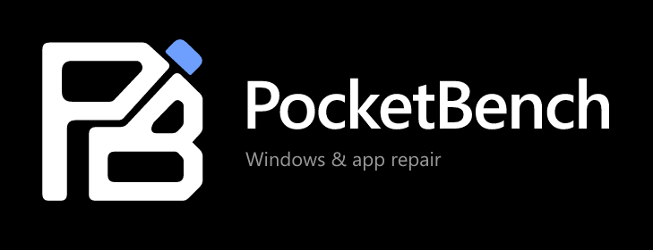

# PocketBench

A Windows desktop repair agent powered by Meta Muse Spark. Investigate Windows and app problems, research version-specific fixes, review their impact, apply supported operations, and verify what changed.

Built during the Meta Global AI Developer Hackathon, beginning October 30, 2026. Custom implementation and contribution records are maintained in this standalone repository.

## Windows download

Download the installer or portable build from [Releases](https://github.com/duschino-source/pocketbench-windows/releases/latest). Windows 11 x64 is the supported target. This event build is unsigned.

Open PocketBench, scan your PC, and describe a problem under Windows or select an installed app. Investigate uses live Meta web search, a structured repair draft, and an independent review. Review sources, affected resources, interruptions, backup coverage, and privileges, then choose **Apply fix**. Only supported local operations can execute. Windows may display UAC.

Settings accepts your Meta Model API key. Windows encrypts the stored key locally; the renderer and distributed packages never receive it. Redacted symptom, OS/app version, and selected diagnostic evidence are sent to Meta for investigation. Diagnostic records and repair backups remain local.

## Coverage

Windows operations cover manual user proxies, DNS cache, selected stopped services, DISM/SFC, and eligible current-user startup entries. App inventory includes registry and current-user Store apps. All inventoried apps can be investigated; executable coverage depends on current capabilities. Exact WinGet updates and deeper Firefox, Steam, and Obsidian operations are documented in [repair coverage](docs/REPAIR-COVERAGE.md).

Community sources can support execution only with independent corroboration. Missing evidence, conflicting sources, unknown operations, and invalid targets withhold execution. Success requires independent postcondition checks. A pending reboot remains pending; Undo is available only where restoration is supported.

## Development

Requires Windows 11 x64 and Node.js 24. Run `npm ci`, then `npm run dev`. Configure your own Meta Model API key in Settings.

`npm run check` runs type checking, automated tests, and the production build. `npm run dist` creates a Windows installer and portable executable.

After building, run `node tools/check-ui.cjs` for isolated checks of text contrast, true-black surfaces, icon loading, reduced motion, and 100–200% renderer zoom. `node tools/generate-icons.cjs` regenerates brand exports from the SVG masters. See [brand provenance and interface rules](docs/BRAND.md).

`node --test tools/gateway.test.mjs` checks metering and credential boundaries. For delegated coding, set `POCKETBENCH_KEY_FILE` to a credential file outside this repository, run `npm run gateway`, then use the checked-in OpenCode provider configuration. The loopback gateway reserves conservative request costs before Meta calls and caps the ledger at $90. It cannot govern unrelated account usage. See [architecture](docs/ARCHITECTURE.md).

## Verification and submission

Read [verification results](docs/VERIFICATION.md), [event contributions](CONTRIBUTIONS.md), the [three-minute demo script](docs/DEMO.md), and [your remaining submission checklist](docs/USER-CHECKLIST.md). Native fault tests run only in disposable GitHub-hosted Windows runners. Paid live-model tests are opt-in and use isolated application data; public CI has no model credential.
